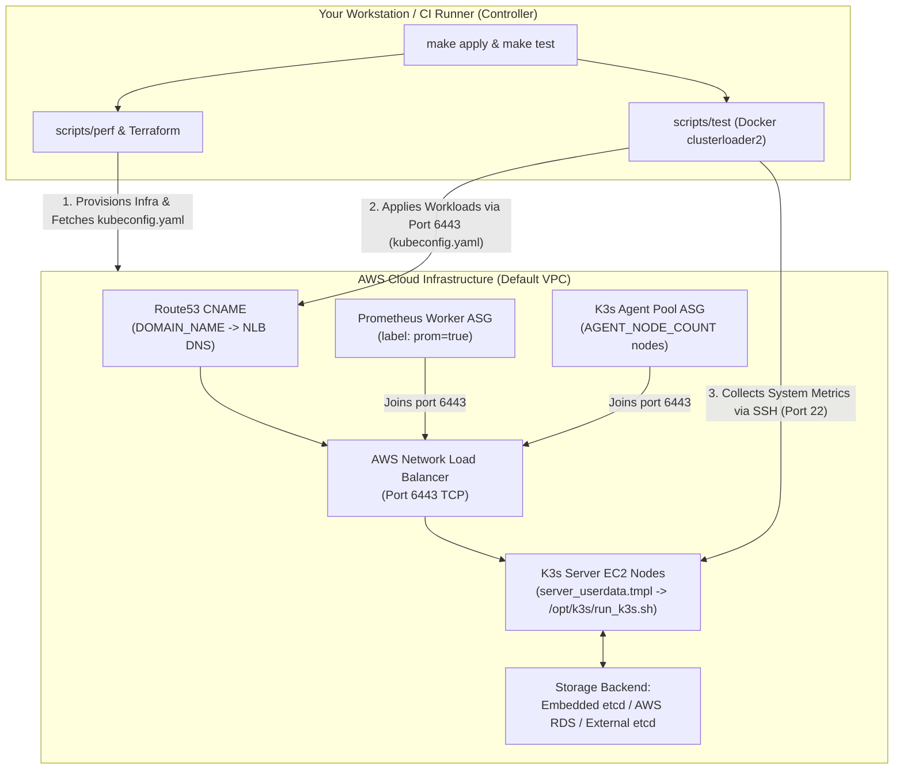

# K3s Performance Testing (`tests/perf`) — AWS Terraform Guide & Alternative Environments

This guide documents the upstream maintenance status, complete architecture, AWS setup, execution lifecycle, monitoring, cleanup, and alternative deployment targets (Proxmox/Bare-Metal, GitHub Actions Runners, and Existing K3s Clusters) for the Terraform + `clusterloader2` performance test suite located in [`tests/perf/`](file:///c:/projects/k3s_new/k3s/tests/perf/README.md).

---

## 0. Upstream Status: Is K3s Actively Using This Terraform Script & AWS Infra?

**No — `tests/perf/` is legacy, unmaintained, and dormant in upstream `k3s-io/k3s`.** It is **not** executed by any upstream CI/CD pipeline, and upstream maintainers have not actively used or updated its Terraform provisioning logic since **2019–2020**.

### Evidence Verified Directly From Repository & Git History

1. **Zero CI/CD Pipeline Integration:**
   * Searching all `.github/workflows/` and `scripts/` confirms **0 GitHub Actions workflows** and **0 automated scripts** invoke `tests/perf`, `scripts/perf`, `scripts/test`, or `clusterloader`.
2. **Git Commit History (`git log -- tests/perf`):**
   * **Created Oct–Nov 2019** (`128eff9b0e`, `2165464af6`, `9969dc9cff`, `93e28126aa`) by contributor `galal-hussein` for K3s `v0.9.1` / `v1.0.0`.
   * **Zero functional Terraform or benchmark updates from 2020 to 2026.** All 6 subsequent commits touching `tests/perf/` were repository-wide mechanical find-and-replace / linter sweeps:
     | Commit | Date | Author | Scope (Mechanical Repo Sweep Only) |
     |---|---|---|---|
     | `5fa0083750` & `4286ba7163` | 2020-03-04 | Joakim Roubert | Shell `$()` backtick & `markdownlint` style cleanup. |
     | `b4d81a9e33` | 2020-08-24 | Brad Davidson | Repo-wide removal of lingering `dqlite` references. |
     | `86be784aa0` | 2022-10-27 | James Blair | Repo-wide migration from deprecated `k8s.gcr.io` to `registry.k8s.io`. |
     | `13c633da12` | 2022-11-04 | Derek Nola | Repo-wide flag cleanup (`--no-deploy` -> `--disable`). |
     | `ade82387f7` | 2025-09-24 | Ben | Repo-wide inclusive naming proposal (`master` -> `primary`, Issue `#12110`). |
3. **Accumulated Code Bitrot & Broken Defaults:**
   Because nobody in upstream K3s runs `tests/perf/` against AWS anymore, multiple breaking issues remain unfixed in the tree:
   * Unpatched syntax typo (`$var.domain_name}` missing `{`) in [`server/main.tf#L234`](file:///c:/projects/k3s_new/k3s/tests/perf/server/main.tf#L234) and missing SSH `StrictHostKeyChecking=no`.
   * Deprecated Terraform AWS data source (`data "aws_subnet_ids"` removed in AWS Provider v5+) in [`server/data.tf#L5`](file:///c:/projects/k3s_new/k3s/tests/perf/server/data.tf#L5) and [`agents/data.tf#L13`](file:///c:/projects/k3s_new/k3s/tests/perf/agents/data.tf#L13).
   * Deprecated `terraform destroy --force` flag (removed in Terraform 0.15+) in [`scripts/perf#L5,L119`](file:///c:/projects/k3s_new/k3s/tests/perf/scripts/perf#L119).
   * EOL software targets: Ubuntu 18.04 (`ubuntu-bionic-18.04-*`), Docker `19.03.sh` ([`etcd.tmpl#L31`](file:///c:/projects/k3s_new/k3s/tests/perf/server/files/etcd.tmpl#L31)), `K3S_VERSION="v1.0.0"` ([`scripts/config#L7`](file:///c:/projects/k3s_new/k3s/tests/perf/scripts/config#L7)), and MySQL `5.7`.
   * Personal Docker Hub image reference (`husseingalal/clusterloader:dev` in [`scripts/test#L12,L32`](file:///c:/projects/k3s_new/k3s/tests/perf/scripts/test#L12)) instead of an official `rancher/` or `registry.k8s.io` container image.
   * Hardcoded personal/internal AWS profile (`profile = "rancher-eng"`).
4. **What Upstream SUSE/Rancher Uses Today Instead:**
   * As noted in [`tests/TESTING.md#L147-L151`](file:///c:/projects/k3s_new/k3s/tests/TESTING.md#L147-L151), Rancher/SUSE QA teams migrated active multi-node provisioning, acceptance, and scale/upgrade validation to the external **[`rancher/distros-test-framework`](https://github.com/rancher/distros-test-framework)** alongside internal Rancher QA automation.

> **Practical Takeaway:** While `tests/perf/` is dormant upstream (and requires the fixes in **Section 3** if you want to run its Terraform AWS scripts), the underlying **`clusterloader2`** workload YAMLs ([`load/config.yaml`](file:///c:/projects/k3s_new/k3s/tests/perf/tests/load/config.yaml) and [`density/config.yaml`](file:///c:/projects/k3s_new/k3s/tests/perf/tests/density/config.yaml)) remain valid Kubernetes scale benchmarks that you can run against any modern K3s cluster (**Sections 5–7**).

---

## 1. Script & File Inventory (`tests/perf/`)

| File / Path | Role | Who Runs It? |
|---|---|---|
| [`tests/perf/Makefile`](file:///c:/projects/k3s_new/k3s/tests/perf/Makefile) | Top-level entrypoint (`init`, `config`, `plan`, `apply`, `destroy`, `clean`, `test`, `info`). | Operator (Local shell / CI runner) |
| [`tests/perf/scripts/perf`](file:///c:/projects/k3s_new/k3s/tests/perf/scripts/perf) | Orchestrates Terraform variable generation (`variables.tfvars`), `init`, `plan`, `apply`, `destroy`, `clean`, and `info`. | Invoked by `Makefile` |
| [`tests/perf/scripts/config`](file:///c:/projects/k3s_new/k3s/tests/perf/scripts/config) | Central parameter file (cluster name, Route53 domain/zone, K3s version, DB engine, node counts, EC2 instance types, SSH key paths). | Sourced by `scripts/perf` and `scripts/test` |
| [`tests/perf/scripts/test`](file:///c:/projects/k3s_new/k3s/tests/perf/scripts/test) | Runs Docker image `husseingalal/clusterloader:dev` (`test_load` or `test_density`) from your workstation/runner against the cluster. | Operator (via `make test` or direct call) |
| [`tests/perf/server/main.tf`](file:///c:/projects/k3s_new/k3s/tests/perf/server/main.tf) | Terraform Layer 1: Provisions AWS Security Group, RDS/etcd, NLB (`port 6443`), Route53 CNAME, K3s server EC2 nodes, Prometheus worker ASG, and fetches `kubeconfig.yaml`. | Invoked by `scripts/perf apply` |
| [`tests/perf/agents/main.tf`](file:///c:/projects/k3s_new/k3s/tests/perf/agents/main.tf) | Terraform Layer 2: Provisions agent security group and K3s worker Auto Scaling Group (`agent_node_count`) reading state from `server/server.tfstate`. | Invoked by `scripts/perf apply` (after 60s sleep) |
| [`tests/perf/server/files/server_userdata.tmpl`](file:///c:/projects/k3s_new/k3s/tests/perf/server/files/server_userdata.tmpl) | Cloud-init template that generates `/opt/k3s/run_k3s.sh` and installs K3s server(s) on boot. | **AWS Cloud-init** (automatically on server EC2 boot) |
| [`tests/perf/server/files/worker_userdata.tmpl`](file:///c:/projects/k3s_new/k3s/tests/perf/server/files/worker_userdata.tmpl) | Cloud-init template installing K3s agent labeled `prom=true` for Prometheus/Grafana monitoring. | **AWS Cloud-init** (automatically on Prometheus EC2 boot) |
| [`tests/perf/agents/files/pool_worker_userdata.tmpl`](file:///c:/projects/k3s_new/k3s/tests/perf/agents/files/pool_worker_userdata.tmpl) | Cloud-init template joining worker pool EC2 nodes to `https://${k3s_url}:6443`. | **AWS Cloud-init** (automatically on worker ASG boot) |
| [`tests/perf/server/files/etcd_build.sh`](file:///c:/projects/k3s_new/k3s/tests/perf/server/files/etcd_build.sh) | SSHs into external etcd EC2 nodes to launch containerized `quay.io/coreos/etcd` when `DB_ENGINE="etcd"`. | Invoked by Terraform `null_resource.run_etcd` |
| [`tests/perf/tests/load/config.yaml`](file:///c:/projects/k3s_new/k3s/tests/perf/tests/load/config.yaml) | Kubernetes `clusterloader2` workload spec (Deployments, Services, StatefulSets, DaemonSets, Jobs, PVs, ConfigMaps). | Mounted into `clusterloader` Docker container |
| [`tests/perf/tests/density/config.yaml`](file:///c:/projects/k3s_new/k3s/tests/perf/tests/density/config.yaml) | Kubernetes `clusterloader2` high-density saturation workload spec (max pods/node & scheduling throughput). | Mounted into `clusterloader` Docker container |

---

## 2. AWS Provisioning & Test Execution Architecture



> **Important Question: "What script do I run inside the AWS infra once it is ready? Who runs it?"**
>
> You do **NOT** SSH into the AWS EC2 instances to manually launch K3s or the load tests:
> 1. **Inside AWS (Automatic):** When EC2 boots, **AWS `cloud-init`** automatically executes `server_userdata.tmpl` (which creates and runs `/opt/k3s/run_k3s.sh`), `worker_userdata.tmpl`, and `pool_worker_userdata.tmpl`.
> 2. **From Your Local Machine / CI Runner (Manual Trigger):** Once Terraform finishes provisioning and retrieves `tests/perf/tests/kubeconfig.yaml`, **your local machine** runs `make test` ([`scripts/test`](file:///c:/projects/k3s_new/k3s/tests/perf/scripts/test)). This starts `clusterloader2` in Docker locally and drives the AWS cluster remotely over HTTPS (`6443`) and SSH (`22`).

---

## 3. Critical Fixes Required Before Running on Your AWS Account

The upstream Terraform files in `tests/perf/` contain Rancher-specific defaults and legacy syntax from earlier Terraform/AWS provider versions. Apply these updates before running `make apply`:

### 3.1 AWS Provider Profile & Region
Both [`tests/perf/server/main.tf#L15-L18`](file:///c:/projects/k3s_new/k3s/tests/perf/server/main.tf#L15-L18) and [`tests/perf/agents/main.tf#L12-L15`](file:///c:/projects/k3s_new/k3s/tests/perf/agents/main.tf#L12-L15) hardcode Rancher's AWS profile and region:
```hcl
provider "aws" {
  region  = "us-east-2"
  profile = "rancher-eng"
}
```
* **Fix Option A:** Create an AWS CLI profile literally named `rancher-eng` (`aws configure --profile rancher-eng`), OR
* **Fix Option B (Recommended):** Edit both `server/main.tf` and `agents/main.tf` to remove `profile = "rancher-eng"` (allowing standard `AWS_PROFILE` / `AWS_ACCESS_KEY_ID` environment variables) and set `region` to your desired AWS region.

### 3.2 Default VPC, Subnet Lookup & Ubuntu AMI Filters
In [`tests/perf/server/data.tf`](file:///c:/projects/k3s_new/k3s/tests/perf/server/data.tf) and [`tests/perf/agents/data.tf`](file:///c:/projects/k3s_new/k3s/tests/perf/agents/data.tf):
1. **Default VPC Required:** `data "aws_vpc" "default" { default = true }` requires a Default VPC with **at least 2 subnets** (`[1]`) in your target AWS region.
2. **AWS Provider v5+ Compatibility:** `data "aws_subnet_ids"` was deprecated in AWS Provider v4 and **removed in AWS Provider v5+**. Either pin `hashicorp/aws` to `~> 3.75` or update both `data.tf` files from `aws_subnet_ids` to `aws_subnets` (`filter { name = "vpc-id", values = [data.aws_vpc.default.id] }`).
3. **Outdated Ubuntu 18.04 AMI Filter:** `values = ["ubuntu-minimal/images/*/ubuntu-bionic-18.04-*"]` targets EOL Ubuntu 18.04. Update to Ubuntu 24.04 (`ubuntu/images/hvm-ssd-gp3/ubuntu-noble-24.04-amd64-server-*`) or Ubuntu 22.04 (`ubuntu/images/hvm-ssd/ubuntu-jammy-22.04-amd64-server-*`) if your target region lacks 18.04 images.

### 3.3 Typo & SSH Prompt Bug in `get-kubeconfig`
In [`tests/perf/server/main.tf#L234`](file:///c:/projects/k3s_new/k3s/tests/perf/server/main.tf#L234):
```hcl
command = "until ssh -i ${var.ssh_key_path} ubuntu@${aws_instance.k3s-server[0].public_ip} 'sudo sed \"s/localhost/$var.domain_name}/g;s/127.0.0.1/${var.domain_name}/g\" /etc/rancher/k3s/k3s.yaml' >| ../tests/kubeconfig.yaml; do sleep 5; done"
```
* Notice `$var.domain_name}` is missing `{` (should be `${var.domain_name}`), and `ssh` lacks `-o StrictHostKeyChecking=no` (which causes Terraform `local-exec` to hang waiting for SSH host confirmation!).
* Fix line 234 to:
  ```hcl
  command = "until ssh -o StrictHostKeyChecking=no -i ${var.ssh_key_path} ubuntu@${aws_instance.k3s-server[0].public_ip} 'sudo sed \"s/localhost/${var.domain_name}/g;s/127.0.0.1/${var.domain_name}/g\" /etc/rancher/k3s/k3s.yaml' >| ../tests/kubeconfig.yaml; do sleep 5; done"
  ```

### 3.4 Spot Instance Price Caps & Route53 Hosted Zone
* [`tests/perf/server/main.tf#L105-L113`](file:///c:/projects/k3s_new/k3s/tests/perf/server/main.tf#L105-L113) requires an existing **AWS Route53 Hosted Zone** (`ZONE_ID`) and matching domain (`DOMAIN_NAME`) in [`scripts/config`](file:///c:/projects/k3s_new/k3s/tests/perf/scripts/config).
* Both ASGs set hardcoded Spot bids: `spot_price = "0.340"` (Prometheus ASG) and `spot_price = "0.680"` (Worker ASG). If current AWS Spot market prices exceed these caps for your chosen instance type, EC2 instances will not launch. Remove `spot_price` (uses On-Demand price as max cap) or switch to On-Demand if stability is preferred over Spot savings.

### 3.5 Testing Company X's Forked K3s Binary
By default, `server_userdata.tmpl` and `pool_worker_userdata.tmpl` install official upstream releases via `curl -sfL https://get.k3s.io | INSTALL_K3S_VERSION="${install_k3s_version}"`.
To test **Company X's forked K3s build**:
* Host your binary in GitHub Releases (`https://github.com/companyx/k3s/releases/download/...`) and update the cloud-init templates (`.tmpl`) to download `k3s` binary into `/usr/local/bin/k3s` and set `INSTALL_K3S_SKIP_DOWNLOAD=true` before piping `get.k3s.io`.

---

## 4. Step-by-Step AWS Execution Guide

### Step 1: Prerequisites & AWS Credentials Setup (Local Controller)
Run on a **Linux or macOS controller** (or **WSL2 Ubuntu** on Windows, since `scripts/perf` and `scripts/test` use bash, `/dev/urandom`, and `readlink -f`).

```bash
# 1. Verify required CLI tools
for bin in docker kubectl terraform aws; do
  command -v $bin || echo "MISSING: $bin"
done

# 2. Authenticate AWS CLI (choose profile matching main.tf, e.g., rancher-eng or default)
aws configure --profile rancher-eng
# Enter AWS Access Key ID, Secret Access Key, region: us-east-2, output: json

# 3. Verify AWS identity & Default VPC subnets exist (>= 2 subnets required)
aws sts get-caller-identity --profile rancher-eng
aws ec2 describe-subnets --filters "Name=default-for-az,Values=true" --region us-east-2 --profile rancher-eng --query "Subnets[].SubnetId"

# 4. Verify Route53 Zone ID for your domain
aws route53 list-hosted-zones --profile rancher-eng --query "HostedZones[].[Id,Name]"
```

Generate or locate your SSH keypair (your public key goes into `EXTRA_SSH_KEYS`, and the private key path goes into `PRIVATE_KEY_PATH`):
```bash
ssh-keygen -t rsa -b 4096 -f ~/.ssh/k3s_perf_rsa -N ""
cat ~/.ssh/k3s_perf_rsa.pub
```

---

### Step 2: Configure AWS Resources & Test Parameters (`tests/perf/scripts/config`)

Edit [`tests/perf/scripts/config`](file:///c:/projects/k3s_new/k3s/tests/perf/scripts/config) to configure your AWS account, Route53 zone, SSH key, K3s version, and hardware sizing:

```bash
cd tests/perf
```

Update `scripts/config` with your values:
```bash
## MAIN VARIABLES ##
CLUSTER_NAME="companyx-perf-k3s"
CLUSTER_SECRET=""                                  # Leave empty to auto-generate 32-char secret
DOMAIN_NAME="perf-k3s.yourdomain.com"              # MUST be inside your Route53 Hosted Zone
ZONE_ID="Z0123456789ABCDEFGHIJ"                    # Your Route53 Hosted Zone ID
K3S_VERSION="v1.31.4+k3s1"                         # Target K3s release to test
EXTRA_SSH_KEYS="ssh-rsa AAAAB3Nza... user@host"    # Contents of ~/.ssh/k3s_perf_rsa.pub
PRIVATE_KEY_PATH="~/.ssh/k3s_perf_rsa"             # Path to your private SSH key
DEBUG=1                                            # 1 = enable --debug logs on k3s servers, 0 = off

## K3S DB VARIABLES ##
DB_ENGINE="embedded-etcd"                          # Options: "embedded-etcd", "etcd", "postgres", "mysql"
DB_INSTANCE_TYPE="db.m5.xlarge"                    # RDS instance class (ignored if embedded-etcd)
DB_NAME="k3s"
DB_USERNAME="k3suser"
DB_PASSWORD=""                                     # Auto-generated if empty
DB_VERSION=5.7                                     # RDS engine version or etcd tag (e.g. v3.5.15)

## K3S SERVER VARIABLES ##
SERVER_HA=1                                        # 1 = HA cluster, 0 = single server SQLite
SERVER_COUNT=3                                     # Number of K3s control-plane EC2 instances
SERVER_INSTANCE_TYPE="m5.2xlarge"                  # Server EC2 instance size (8 vCPU, 32 GB RAM)

## PROMETHEUS SERVER VARIABLES ##
PROM_WORKER_NODE_COUNT=1                           # Dedicated worker(s) labeled prom=true
PROM_WORKER_INSTANCE_TYPE="m5.large"               # Prometheus/Grafana EC2 size

## K3S AGENTS VARIABLES ##
AGENT_NODE_COUNT=10                                # Number of worker EC2 instances in ASG
AGENT_INSTANCE_TYPE="m5.large"                     # Agent EC2 size (2 vCPU, 8 GB RAM)
```

#### How to Change AWS Resource Configuration
1. **Change Node Count or EC2 Sizing:** Update `SERVER_COUNT`, `SERVER_INSTANCE_TYPE`, `AGENT_NODE_COUNT`, `AGENT_INSTANCE_TYPE`, `PROM_WORKER_INSTANCE_TYPE` in `scripts/config`.
2. **Switch Storage Backend:** Set `DB_ENGINE` to:
   - `"embedded-etcd"` (requires `SERVER_HA=1`, `SERVER_COUNT=3` or `5`)
   - `"mysql"` / `"postgres"` (provisions `aws_db_instance` RDS; set `DB_VERSION="15.4"` for Postgres or `"8.0"` for MySQL)
   - `"etcd"` (provisions external EC2 etcd nodes configured by [`etcd_build.sh`](file:///c:/projects/k3s_new/k3s/tests/perf/server/files/etcd_build.sh))
   - `SERVER_HA=0` and `SERVER_COUNT=1` for single-node SQLite.
3. **Change Disk Size or AWS Region:** Edit `volume_size = "30"` or `provider "aws" { region = "..." }` inside [`server/main.tf`](file:///c:/projects/k3s_new/k3s/tests/perf/server/main.tf) and [`agents/main.tf`](file:///c:/projects/k3s_new/k3s/tests/perf/agents/main.tf).
4. **Apply Changes to Running Infra:** Run `make config && make plan && make apply`.

---

### Step 3: Adjust `clusterloader2` Workload Sizing (Important!)

Check [`tests/perf/tests/load/config.yaml#L8-L11`](file:///c:/projects/k3s_new/k3s/tests/perf/tests/load/config.yaml#L8-L11) and [`tests/perf/tests/density/config.yaml#L8-L10`](file:///c:/projects/k3s_new/k3s/tests/perf/tests/density/config.yaml#L8-L10):
* `load/config.yaml` computes namespaces via `{{$namespaces := DivideInt .Nodes $NODES_PER_NAMESPACE}}`. Default `NODES_PER_NAMESPACE` is **`10`** (meaning if you have fewer than 10 nodes, `$namespaces = 0` and tests fail or run 0 namespaces!).
* `density/config.yaml` defaults `NODES_PER_NAMESPACE` to **`100`** (designed for 100+ node clusters).
* **For a 10–15 node cluster:** Keep `NODES_PER_NAMESPACE = 10` for `load/config.yaml`, or update line 8 of `density/config.yaml` to `{{$NODES_PER_NAMESPACE := DefaultParam .NODES_PER_NAMESPACE 10}}` before running `test_density`.

---

### Step 4: Trigger AWS Provisioning

Run from `tests/perf`:
```bash
cd tests/perf

# Option A: Preview what Terraform will create before spending money
make init
make config
make plan

# Option B: Full automated initialization, variable generation, and AWS provisioning
make apply
```

**What `make apply` executes internally ([`scripts/perf#L19-L35`](file:///c:/projects/k3s_new/k3s/tests/perf/scripts/perf#L19-L35)):**
1. Runs `terraform init` in `server/` and `agents/`.
2. Generates `server/variables.tfvars` and `agents/variables.tfvars` from `scripts/config`.
3. Runs `terraform plan` + `terraform apply` inside `server/`.
4. Polls SSH on `k3s-server[0]` until `/etc/rancher/k3s/k3s.yaml` exists and saves it locally to `tests/perf/tests/kubeconfig.yaml`.
5. Sleeps 60 seconds, then runs `terraform plan` + `terraform apply` inside `agents/` to scale up the worker pool ASG.

---

### Step 5: Check Cluster Status & Verify What Ran Inside AWS

Check infrastructure outputs and cluster health **from your local workstation**:
```bash
# View Terraform outputs (Server IPs, K3s version, Domain)
cd tests/perf
make info

# Verify all K3s nodes (servers + prom node + agent pool) joined and are Ready
export KUBECONFIG=$PWD/tests/kubeconfig.yaml
kubectl get nodes -o wide --show-labels
kubectl get pods -A
```

*(Optional Troubleshooting Only)* If nodes fail to join after 3–5 minutes, SSH into a server instance to inspect the automated cloud-init script that ran inside AWS:
```bash
SERVER_IP=$(terraform -chdir=server output -raw k3s_server_ips | cut -d',' -f1)
ssh -i ~/.ssh/k3s_perf_rsa ubuntu@$SERVER_IP "sudo tail -n 100 /var/log/cloud-init-output.log"
ssh -i ~/.ssh/k3s_perf_rsa ubuntu@$SERVER_IP "sudo cat /opt/k3s/run_k3s.sh && sudo systemctl status k3s"
```

---

### Step 6: Trigger the Performance Test

Once `kubectl get nodes` shows `Ready` for all servers, Prometheus worker (`prom=true`), and agent nodes:

```bash
cd tests/perf

# Run the Kubernetes Load Test (Deployments, Services, StatefulSets, PVs, DNS, Network Latency)
make test
# (Equivalent to: ./scripts/test test_load)

# OR run the Density Saturation Test (Maximum Pod density & Scheduling Throughput)
./scripts/test test_density
```

**Behind the scenes**, [`scripts/test`](file:///c:/projects/k3s_new/k3s/tests/perf/scripts/test#L9-L40) launches `husseingalal/clusterloader:dev`, mounts `tests/kubeconfig.yaml` and your `PRIVATE_KEY_PATH`, enables Prometheus inside the cluster (`--enable-prometheus-server`), leaves Prometheus running after completion (`--tear-down-prometheus-server=0`), and writes reports into `tests/perf/tests/load_tests_results-<RANDOM>/` or `density_tests_results-<RANDOM>/`.

---

### Step 7: How to Monitor the Test While Running

1. **Clusterloader2 Live Terminal Output:** Follow real-time test phase logs (`Creating pods`, `Waiting for pods`, `APIResponsiveness`, latency percentiles `P50/P90/P99`) directly in stdout or run in `tmux`/`screen` and redirect output:
   ```bash
   ./scripts/test test_load 2>&1 | tee perf_run_$(date +%F_%H%M).log
   ```
2. **Watch Kubernetes Workloads & Node Utilization:** In a second terminal:
   ```bash
   export KUBECONFIG=$PWD/tests/kubeconfig.yaml
   watch -n 5 "kubectl get nodes && kubectl get ns | grep test-"
   kubectl top nodes
   ```
3. **Prometheus & Grafana Dashboards (Port-Forward from Local Machine):** Because `scripts/test` passes `--enable-prometheus-server` and `--tear-down-prometheus-server=0`, `clusterloader2` deploys Prometheus & Grafana inside namespace `monitoring`:
   ```bash
   kubectl -n monitoring get svc,pods
   kubectl -n monitoring port-forward svc/prometheus-k8s 9090:9090 &
   kubectl -n monitoring port-forward svc/grafana 3000:3000 &
   # Open http://localhost:9090 (Prometheus) and http://localhost:3000 (Grafana)
   ```
4. **Inspect Final Report Metrics:** When finished, read the generated JSON/JUnit summaries in:
   ```bash
   ls -la tests/perf/tests/load_tests_results-*/
   cat tests/perf/tests/load_tests_results-*/APIResponsivenessPrometheus_load_*.json
   cat tests/perf/tests/load_tests_results-*/PodStartupLatency_load_*.json
   ```

---

### Step 8: How to Stop an In-Progress Test

If you need to abort a test mid-run:
```bash
# 1. Stop the clusterloader2 Docker container cleanly
docker ps --filter ancestor=husseingalal/clusterloader:dev -q | xargs -r docker stop

# 2. (Optional) Clean leftover load-test namespaces if cluster remains up for re-testing
export KUBECONFIG=tests/perf/tests/kubeconfig.yaml
kubectl get ns --no-headers | awk '/^test-|^monitoring$/ {print $1}' | xargs -r kubectl delete ns --wait=false
```

---

### Step 9: Cleanup After Execution (CRITICAL to Avoid AWS Charges!)

> **Note:** Terraform `agents/` state depends on `server/server.tfstate`, so **you MUST destroy `agents/` BEFORE `server/`** (which `make destroy` handles in order).

```bash
cd tests/perf

# 1. Destroy AWS ASGs, EC2s, NLB, Route53 record, RDS, and Security Groups
make destroy

# 2. Remove local Terraform plans, tfvars, tfstate files
make clean

# 3. Also remove generated kubeconfig and old test result folders if desired
./scripts/perf cleanall
```

#### Mandatory AWS Safety Verification (Avoid Orphaned Costs!)
Older Terraform `0.12` syntax (`--force`) can sometimes error on newer Terraform CLI (`-auto-approve` replaced `--force` in Terraform 0.15+), leaving infrastructure running. **Always run this check after `make destroy`:**
```bash
# Confirm 0 running EC2 instances, 0 RDS DBs, 0 Load Balancers, and 0 ASGs remain
aws ec2 describe-instances --filters "Name=instance-state-name,Values=running,pending" --region us-east-2 --profile rancher-eng --query "Reservations[].Instances[].[InstanceId,Tags[?Key=='Name'].Value|[0]]"
aws autoscaling describe-auto-scaling-groups --region us-east-2 --profile rancher-eng --query "AutoScalingGroups[].AutoScalingGroupName"
aws elbv2 describe-load-balancers --region us-east-2 --profile rancher-eng --query "LoadBalancers[].LoadBalancerName"
aws rds describe-db-instances --region us-east-2 --profile rancher-eng --query "DBInstances[].DBInstanceIdentifier"
```
*(If `terraform destroy --var-file variables.tfvars --force` fails due to modern Terraform CLI rejecting `--force`, change line 119 of [`tests/perf/scripts/perf`](file:///c:/projects/k3s_new/k3s/tests/perf/scripts/perf#L119) from `--force` to `-auto-approve`.)*

---

## 5. Running Performance Tests on Other Environments (Proxmox, Bare-Metal, Azure, GCP)

**Yes — 100% possible.** Terraform is **only** an optional AWS provisioner; the benchmark engine (`clusterloader2`) is completely cloud-agnostic.

### How to Run on Your On-Prem Proxmox Cluster / Other Cloud VMs:
1. **Provision VMs Anywhere:**
   - Spin up your K3s server(s) and agent VMs on Proxmox VE (using `bpg/proxmox` Terraform provider or Ansible), Azure, GCP, or bare-metal servers.
   - Install your forked K3s binary on the server and agent VMs.
   - Label one worker node for Prometheus if using `--enable-prometheus-server`:
     ```bash
     kubectl label node <worker-node-name> prom=true
     ```
2. **Prepare `kubeconfig.yaml` & SSH:**
   - Copy `/etc/rancher/k3s/k3s.yaml` from a control-plane node to `tests/perf/tests/kubeconfig.yaml` and replace `127.0.0.1` with the control-plane VIP/IP.
   - Ensure your controller machine has SSH access (`~/.ssh/id_rsa`) to the server IP(s).
3. **Run `clusterloader2` Directly Against the Cluster:**
   Bypass `scripts/test` (which looks up `terraform output`) and run Docker directly:
   ```bash
   cd tests/perf/tests
   MASTER_IP="192.168.10.50" # Comma-separated if HA servers
   SSH_USER="ubuntu"         # Or root / rocky / your VM user

   docker run --rm \
     -v ~/.ssh/id_rsa:/opt/priv_key:ro \
     -e KUBE_SSH_USER=$SSH_USER \
     -e LOCAL_SSH_KEY=/opt/priv_key \
     -v $PWD:/opt/k3s/perf-tests \
     husseingalal/clusterloader:dev \
     clusterloader \
       --testconfig /opt/k3s/perf-tests/load/config.yaml \
       --kubeconfig /opt/k3s/perf-tests/kubeconfig.yaml \
       --masterip "$MASTER_IP" \
       --provider=local \
       --nodes=$(kubectl --kubeconfig kubeconfig.yaml get nodes --no-headers | wc -l) \
       --report-dir /opt/k3s/perf-tests/proxmox_results-$(date +%s) \
       --enable-prometheus-server \
       --tear-down-prometheus-server=0
   ```

---

## 6. Running Performance Tests on a GitHub Actions Runner

There are **two ways** to use GitHub Actions Runners with this suite, with very different use cases:

### Pattern A (Recommended): GitHub Runner as the Controller -> Targeting AWS or On-Prem Proxmox
Use a standard `ubuntu-latest` GitHub Runner ($0.00 cost) as the **orchestration engine** that runs Terraform/SSH against external nodes and archives JSON latency reports as GitHub workflow artifacts.

* **Limits & Compatibility:** Works comfortably within GitHub's 6-hour job timeout and 7 GB RAM limit because the heavy pods and Prometheus run remotely on AWS or your Proxmox server.
* **Sample `.github/workflows/performance-test.yaml`:**
  ```yaml
  name: K3s Performance Test
  on:
    workflow_dispatch:
      inputs:
        target_env:
          type: choice
          options: [existing-kubeconfig, aws-ephemeral]
          default: existing-kubeconfig
        workload:
          type: choice
          options: [load, density]
          default: load

  jobs:
    perf-benchmark:
      runs-on: ubuntu-latest
      timeout-minutes: 120
      steps:
        - uses: actions/checkout@v4

        - name: Write Kubeconfig & SSH Key (for Existing / Proxmox target)
          if: inputs.target_env == 'existing-kubeconfig'
          run: |
            echo "${{ secrets.PERF_KUBECONFIG_B64 }}" | base64 -d > tests/perf/tests/kubeconfig.yaml
            echo "${{ secrets.PERF_SSH_PRIVATE_KEY }}" > ~/.ssh/perf_key
            chmod 600 ~/.ssh/perf_key

        - name: Run ClusterLoader2 Benchmark
          run: |
            NODES=$(kubectl --kubeconfig tests/perf/tests/kubeconfig.yaml get nodes --no-headers | wc -l)
            docker run --rm --network host \
              -v ~/.ssh/perf_key:/opt/priv_key:ro \
              -e KUBE_SSH_USER=${{ vars.PERF_SSH_USER || 'ubuntu' }} \
              -e LOCAL_SSH_KEY=/opt/priv_key \
              -v "$PWD/tests/perf/tests:/opt/k3s/perf-tests" \
              husseingalal/clusterloader:dev \
              clusterloader \
                --testconfig /opt/k3s/perf-tests/${{ inputs.workload }}/config.yaml \
                --kubeconfig /opt/k3s/perf-tests/kubeconfig.yaml \
                --masterip "${{ secrets.PERF_MASTER_IP }}" \
                --provider=local \
                --nodes="$NODES" \
                --report-dir /opt/k3s/perf-tests/results \
                --enable-prometheus-server=false

        - name: Upload Performance Report
          uses: actions/upload-artifact@v4
          if: always()
          with:
            name: k3s-perf-results-${{ inputs.workload }}
            path: tests/perf/tests/results/
  ```

### Pattern B: Running *Both* K3s Nodes (via `k3d` / Docker) AND `clusterloader2` Inside One GitHub Runner
* **Is it possible?** **Yes, strictly for small-scale control-plane / functional smoke benchmarking**, not real production sizing.
* **Hard Hardware Constraints:** Standard GitHub public runners (`ubuntu-latest` / `ubuntu-24.04`) provide **2 vCPU (or 4 vCPU on public OSS runners), 7–16 GB RAM, and 14 GB free SSD**.
* **Why Full Load Tests Fail Here:** Default `load/config.yaml` launches 30 pods/node across 10+ nodes (300–5,000+ pods) plus Prometheus. On a single runner VM, that triggers Linux OOM kills, severe CPU throttling, and zero real multi-node network latency because all `k3d` nodes share a single kernel/NIC.
* **How to Run a Scaled-Down Smoke Benchmark Inside a Runner:**
  1. Spin up a 3-node `k3d` Docker cluster (`k3d cluster create perf-smoke --agents 2 --image ghcr.io/companyx/k3s:latest`).
  2. Export kubeconfig (`k3d kubeconfig get perf-smoke > tests/perf/tests/kubeconfig.yaml`).
  3. Create a lightweight override file (`override.yaml`) reducing scale:
     ```yaml
     NODES_PER_NAMESPACE: 1
     PODS_PER_NODE: 5
     ENABLE_CHAOSMONKEY: false
     ```
  4. Run `clusterloader2` with `--provider=skeleton` (disables SSH node telemetry since `k3d` containers don't run `sshd`), `--enable-prometheus-server=false`, and `--testoverrides=/opt/k3s/perf-tests/override.yaml`.

---

## 7. Running Performance Tests on an Existing K3s Cluster

**Yes — directly supported without modifying Terraform.** Look at [`tests/perf/scripts/test`](file:///c:/projects/k3s_new/k3s/tests/perf/scripts/test): the only AWS/Terraform dependency in `scripts/test` is line 7 (`masterips=$(terraform output ...)`).

### Mode 1: Full Telemetry Mode (With SSH Access + Prometheus Server)
Use this when you have SSH access to the existing K3s control-plane nodes and want full API latency + node CPU/RAM Prometheus graphs:
```bash
cd tests/perf/tests

# 1. Copy your existing cluster kubeconfig here (ensure server URL is reachable IP, not 127.0.0.1)
cp ~/.kube/config ./kubeconfig.yaml

# 2. Check node count & label one node for Prometheus (if using default node affinity)
kubectl --kubeconfig kubeconfig.yaml get nodes
kubectl --kubeconfig kubeconfig.yaml label node <your-worker-node> prom=true --overwrite

# 3. Adjust NODES_PER_NAMESPACE if you have < 10 nodes (e.g., set NODES_PER_NAMESPACE=1 or create override)
cat << 'EOF' > ./existing_override.yaml
NODES_PER_NAMESPACE: 1
PODS_PER_NODE: 15
EOF

# 4. Run clusterloader2
NODE_COUNT=$(kubectl --kubeconfig kubeconfig.yaml get nodes --no-headers | wc -l)
MASTER_IP="<YOUR_EXISTING_K3S_SERVER_IP>"

docker run --rm \
  -v ~/.ssh/id_rsa:/opt/priv_key:ro \
  -e KUBE_SSH_USER=root \
  -e LOCAL_SSH_KEY=/opt/priv_key \
  -v "$PWD:/opt/k3s/perf-tests" \
  husseingalal/clusterloader:dev \
  clusterloader \
    --testconfig /opt/k3s/perf-tests/load/config.yaml \
    --testoverrides /opt/k3s/perf-tests/existing_override.yaml \
    --kubeconfig /opt/k3s/perf-tests/kubeconfig.yaml \
    --masterip "$MASTER_IP" \
    --provider=local \
    --nodes="$NODE_COUNT" \
    --report-dir /opt/k3s/perf-tests/existing_cluster_results-$(date +%s) \
    --enable-prometheus-server \
    --tear-down-prometheus-server=1
```
*(Setting `--tear-down-prometheus-server=1` cleans up the monitoring stack automatically when finished so your existing cluster stays clean!)*

### Mode 2: Kubeconfig-Only Mode (No SSH Access Required — `--provider=skeleton`)
If security policies block SSH access to your existing K3s control-plane nodes (e.g., managed production or hardened staging clusters), run `clusterloader2` purely over Kubernetes API port `6443` using `--provider=skeleton` and disabling Prometheus SSH probes:
```bash
cd tests/perf/tests
NODE_COUNT=$(kubectl --kubeconfig kubeconfig.yaml get nodes --no-headers | wc -l)

docker run --rm \
  -v "$PWD:/opt/k3s/perf-tests" \
  husseingalal/clusterloader:dev \
  clusterloader \
    --testconfig /opt/k3s/perf-tests/load/config.yaml \
    --testoverrides /opt/k3s/perf-tests/existing_override.yaml \
    --kubeconfig /opt/k3s/perf-tests/kubeconfig.yaml \
    --provider=skeleton \
    --nodes="$NODE_COUNT" \
    --report-dir /opt/k3s/perf-tests/existing_api_only_results-$(date +%s) \
    --enable-prometheus-server=false \
    --enable-exec-service=false
```
> **Cleanup Check on Existing Clusters:** `clusterloader2` creates temporary `test-*` namespaces and deletes them at the end of a successful run. If aborted early, verify zero leftover namespaces remain:
> ```bash
> kubectl --kubeconfig kubeconfig.yaml get ns | grep test-
> ```

---

## 8. `clusterloader` Workflow Usage & Running Upstream `rancher/distros-test-framework`

### 8.1 Which Workflows in This Repo Use `clusterloader`?
**None — 0 workflows in `.github/workflows/` use `clusterloader`.**

Verified via repository-wide search (`git grep -n -i "clusterloader\|distros-test-framework"`):
* **0 GitHub Actions workflows** (`.github/workflows/`) and **0 build scripts** (`scripts/`) invoke `clusterloader`, `tests/perf/`, `scripts/perf`, or `scripts/test`.
* The **only** executable references in the repository are [`tests/perf/scripts/test`](file:///c:/projects/k3s_new/k3s/tests/perf/scripts/test#L12-L33) and [`tests/perf/Makefile`](file:///c:/projects/k3s_new/k3s/tests/perf/Makefile#L23-L24), which are manually triggered from a workstation.

---

### 8.2 Running Rancher's External `rancher/distros-test-framework`

As noted in [`tests/TESTING.md#L147-L151`](file:///c:/projects/k3s_new/k3s/tests/TESTING.md#L147-L151), active Rancher QA multi-node acceptance and upgrade testing lives in the **separate external repository** [`rancher/distros-test-framework`](https://github.com/rancher/distros-test-framework)—it is **not** inside this `k3s` repository and is **not** triggered automatically by `k3s` GitHub Actions workflows.

It combines **Go**, **Ginkgo/Gomega** (BDD assertions), and **Terraform/OpenTofu** (cloud or VM provisioning) across AWS/cloud providers and local/Docker execution targets.

#### Manual Execution Steps (Workstation / QA Jumpbox)
1. **Prerequisites:** Install **Go** (matching the framework's `go.mod`), **Terraform** or **OpenTofu**, the **Ginkgo CLI** (`go install github.com/onsi/ginkgo/v2/ginkgo`), and cloud CLI credentials (or Docker for local runs).
2. **Clone & Configure:**
   ```bash
   git clone https://github.com/rancher/distros-test-framework.git
   cd distros-test-framework
   ```
   Copy/edit the sample configuration templates under `docs/examples/` and `config/` (`.env`, `.tfvars`, or provider YAML such as `aws.yaml`) to specify distro (`k3s`), server/agent node counts, OS AMIs, and the target K3s version. Consult the checked-out branch's `README.md` and `Makefile` for exact variable names.
3. **Execute Entrypoint Suites via `go test` or `ginkgo`:**
   ```bash
   # Run a specific validation entrypoint suite
   go test -v ./entrypoint/validatecluster/... -ginkgo.v -ginkgo.focus="cluster validation"

   # Or run via Ginkgo CLI
   ginkgo -v ./entrypoint/<suite-dir>
   ```
   Terraform provisions the nodes, Ginkgo runs CNI/storage/workload/upgrade checks, and post-test teardown hooks destroy the infrastructure.

---

### 8.3 How to Trigger `distros-test-framework` in Your Fork & Enterprise

Because `distros-test-framework` is external to your K3s fork, connect them using the following pattern:

1. **Fork & Point to Company X K3s Artifacts:**
   * Fork `rancher/distros-test-framework` into your company GitHub organization (`github.com/companyx/distros-test-framework`).
   * Point its K3s install configuration to **Company X's forked binaries/images** (hosted in GitHub Releases, `ghcr.io`, or internal Harbor) instead of upstream `get.k3s.io` defaults.

2. **Integrate Triggering into Your K3s Fork CI/CD:**
   * **Option A — Cross-Repo Trigger from Release / Nightly Workflow:**
     Add a step at the end of your K3s fork's release or nightly workflow (`release.yml`) calling `gh workflow run` (or `repository_dispatch`) against `companyx/distros-test-framework`, passing your newly built K3s tag/version as a dispatch input.
   * **Option B — Multi-Repo Checkout Workflow:**
     Create a scheduled/manual GitHub Actions workflow in your K3s fork (e.g., `.github/workflows/acceptance-qa.yml`) that checks out `companyx/distros-test-framework`, renders `.env` / `config.yaml` from org secrets & variables, runs `go test -v ./entrypoint/... -ginkgo.v`, uploads diagnostic logs (`journalctl`, cluster status) as artifacts, and ensures `terraform destroy` executes in an `if: always()` cleanup step.

3. **Choose the Execution Infrastructure for Your Enterprise:**
   * **AWS Cloud Parity (via GitHub Actions + OIDC):** Ideal for testing full OS matrices (Ubuntu, RHEL, Rocky, Windows) without storing static long-lived AWS keys in GitHub Secrets.
   * **Zero-Cloud-Spend Internal QA (Self-Hosted Runner on Proxmox VE):** Run `distros-test-framework`'s local/Docker mode on a self-hosted GitHub Actions Runner attached to your on-premises Proxmox server, or adapt its Terraform modules to a Proxmox/vSphere provider for internal VM acceptance runs.
