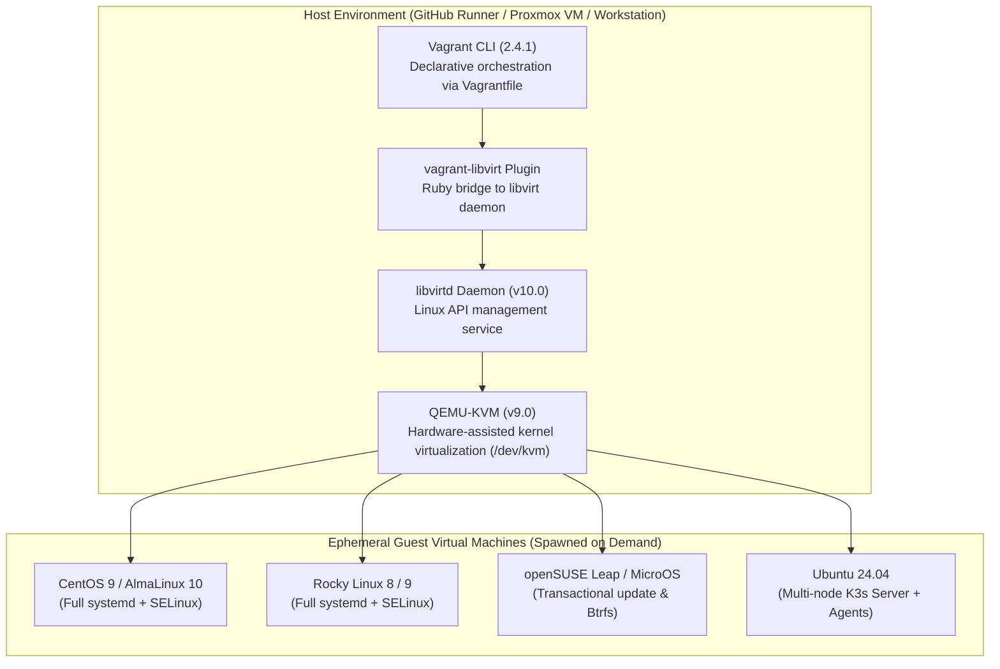

# Vagrant / Libvirt Test VMs: Architecture, Procurement Audit, and Enterprise Setup Guide

## Executive Summary

| Evaluation Question | Fact-Checked Finding |
|---|---|
| **What is it?** | Ephemeral Linux VM automation stack combining **HashiCorp Vagrant** (CLI & declarative `Vagrantfile`) + **Libvirt / QEMU-KVM** (Linux kernel hypervisor via `/dev/kvm`) + **`vagrant-libvirt`** provider plugin. |
| **Does K3s use this?** | **Yes — heavily.** It is the primary testing engine for [`install.yaml`](file:///c:/projects/k3s_new/k3s/.github/workflows/install.yaml) (8-OS matrix), [`e2e.yaml`](file:///c:/projects/k3s_new/k3s/.github/workflows/e2e.yaml) (15 multi-node cluster suites), and [`nightly-install.yaml`](file:///c:/projects/k3s_new/k3s/.github/workflows/nightly-install.yaml) across 23+ `Vagrantfile` definitions. |
| **Why did it appear in the Table as "Paid / Quote Required"?** | In the financial master list (`master_list` Rows 1060 & 1085), a **$100/mo x 12 = $1,200/year contingency reserve** was budgeted for leasing an external bare-metal cloud instance (e.g., Equinix Metal or Hetzner). This contingency was intended only if an enterprise's security policy prohibited nested virtualization on public cloud runners. **It is not a software license fee.** |
| **Which subscription do you need to purchase?** | **None ($0.00).** HashiCorp sells enterprise editions for Vault, Terraform, Nomad, and Consul, but **Vagrant has no commercial enterprise edition or paid seat license**. Libvirt and QEMU-KVM are free open-source system software. |
| **How can you use it in your enterprise?** | **Choice A (Recommended):** Directly on GitHub Actions standard `ubuntu-24.04` runners using free built-in nested `/dev/kvm` (**$0.00**).<br>**Choice B:** On your planned on-premises Proxmox VE server as a self-hosted runner (**$0.00**).<br>**Choice C:** Locally on developer workstations (**$0.00**). |

---

## 1. What Is "Vagrant/libvirt test VMs"?

The entry **"Vagrant/libvirt test VMs"** refers to a complete Linux virtualization automation stack composed of four distinct components:



1. **HashiCorp Vagrant (CLI & Workflow):**
   A tool for building and distributing development environments. It uses a Ruby-based configuration file named `Vagrantfile` to define machine specifications (CPUs, RAM, networks) and provisioning scripts.
2. **Libvirt (`libvirtd`):**
   An open-source toolkit and daemon (licensed under **LGPL-2.1+**) that provides a stable API for managing platform virtualization technologies (specifically KVM and QEMU on Linux).
3. **QEMU-KVM Hypervisor:**
   The underlying Linux kernel module (`kvm.ko`, exposed via `/dev/kvm`) and emulator (licensed under **GPL-2.0**) that provides near-bare-metal virtual machine execution speed using hardware acceleration (Intel VT-x / AMD-V).
4. **`vagrant-libvirt` Plugin:**
   An open-source Vagrant provider plugin that translates Vagrant commands (`vagrant up`, `vagrant halt`, `vagrant destroy`) into Libvirt XML domain definitions and API calls, avoiding the need for heavy desktop hypervisors like VirtualBox or VMware.

---

## 2. Does K3s Use This? (Deep Repository Evidence)

**Yes — K3s relies on Vagrant and Libvirt as its primary operating-system validation engine.**

### 2.1 Workflow Pipeline Evidence

| Pipeline File | Workflow Name | Role of Vagrant / Libvirt | Exact Lines in Codebase |
|---|---|---|---|
| [`.github/actions/vagrant-setup/action.yaml`](file:///c:/projects/k3s_new/k3s/.github/actions/vagrant-setup/action.yaml) | `Setup Vagrant and Libvirt` | Composite GitHub Action called before every VM test to install Vagrant `2.4.1-1`, Libvirt daemons, build dependencies, and plugins on Ubuntu runners. | Lines 20–38: `apt-get install -y libvirt-daemon libvirt-daemon-system vagrant=2.4.1-1 ruby-libvirt` |
| [`.github/workflows/install.yaml`](file:///c:/projects/k3s_new/k3s/.github/workflows/install.yaml) | `Install Script` | Spawns clean, non-containerized Linux operating systems to test `install.sh` installation, systemd service lifecycle, and SELinux enforcement across 8 distributions. | Lines 173–225: Matrix of `[alma-10, centos-9, fedora, opensuse-leap, opensuse-microos, rocky-8, rocky-9, ubuntu-2404]` |
| [`.github/workflows/e2e.yaml`](file:///c:/projects/k3s_new/k3s/.github/workflows/e2e.yaml) | `E2E Test Coverage` | Spawns multi-node VM clusters (servers + workers) on private virtual networks to validate 15 complex cluster scenarios that cannot run inside basic Docker containers. | Lines 190–234: `startup`, `s3`, `embeddedmirror`, `privateregistry`, `wasm`, `externalip`, `rootless`, `multus`, `btrfs`, `splitserver`, `rotateca`, `secretsencryption`, `validatecluster`, `tailscale`, `dualstack` |
| [`.github/workflows/nightly-install.yaml`](file:///c:/projects/k3s_new/k3s/.github/workflows/nightly-install.yaml) | `Nightly Install` | Nightly regression runs provisioning Vagrant VMs across the full OS matrix, testing external databases (`mysql`, `postgres`, `etcd`). | Lines 136–180: Automated nightly VM matrix validation |

### 2.2 Repository Vagrantfiles (23+ Configuration Files)
* **Install Matrix (8 Vagrantfiles):** Located in [`tests/install/<distro>/Vagrantfile`](file:///c:/projects/k3s_new/k3s/tests/install/) for `alma-10`, `centos-9`, `fedora`, `opensuse-leap`, `opensuse-microos`, `rocky-8`, `rocky-9`, and `ubuntu-2404`.
* **E2E Test Scenarios (15 Vagrantfiles):** Located in [`tests/e2e/<scenario>/Vagrantfile`](file:///c:/projects/k3s_new/k3s/tests/e2e/) configuring multi-node topologies (e.g., 3 control-plane servers + 2 agent nodes).
* **Shared Provider Configuration:** [`tests/e2e/vagrantdefaults.rb`](file:///c:/projects/k3s_new/k3s/tests/e2e/vagrantdefaults.rb) standardizes Libvirt CPU allocations, memory limits, and guest network drivers.

---

## 3. Why Did This Appear in Your Table as "Paid / Quote Required"?

In the project cost spreadsheets ([`workflow-fixes/data1.xlsx`](file:///c:/projects/k3s_new/k3s/workflow-fixes/data1.xlsx) and [`workflow-fixes/infra_tool_estimate.xlsx`](file:///c:/projects/k3s_new/k3s/workflow-fixes/infra_tool_estimate.xlsx)), the upstream entries for Vagrant/libvirt list:
* **Published Cost:** `$0.00`
* **Quote Cost:** `$1,200.00 / year` ($100/month)
* **Remark:** `Paid / Quote Required`

### The Truth Behind This Classification:
1. **The Software Is 100% Free:**
   Vagrant is licensed under BSL 1.1 (free for internal enterprise development and testing); Libvirt is LGPL-2.1+; QEMU is GPL-2.0. Neither HashiCorp nor the Linux Foundation charges software licensing fees for these tools.
2. **Upstream GitHub Runner Execution Is 100% Free:**
   Upstream K3s runs these tests on standard `ubuntu-24.04` GitHub Actions runners. GitHub exposes Azure's hardware-assisted nested virtualization device (`/dev/kvm`) at **$0.00 extra cost** for public open-source repositories.
3. **The "$1,200/Year Quote Required" Was an Infrastructure Contingency Reserve:**
   When the upstream cost inventory was authored, the evaluator budgeted an **external hosting contingency** ($100/mo x 12 = $1,200/yr) to lease an external dedicated bare-metal cloud instance (e.g., Equinix Metal, AWS EC2 Bare Metal, or a Hetzner server).
   * **Why?** In the event that an enterprise's IT security policy explicitly banned running nested KVM inside multi-tenant cloud runners, or if private runners lacked nested virtualization support, the team would need to lease an external bare-metal server to host Libvirt.
   * **In Practice:** Upstream K3s **never uses external cloud VMs**. It runs 100% of its Vagrant tests inside standard GitHub-hosted runners.

---

## 4. Which Subscription Do You Need to Purchase?

**Answer: NONE ($0.00). No purchase order (PO) or subscription is required.**

| Vendor / Component | Subscription Tiers Available | Does Your Enterprise Need to Buy It? | Reason & Legal Assessment |
|---|---|---|---|
| **Vagrant (HashiCorp / IBM)** | **None** (Community CLI only) | **No ($0.00)** | HashiCorp sells commercial enterprise licenses for Vault, Terraform, Consul, and Nomad, but **Vagrant has no commercial Enterprise edition or paid seat license**. HashiCorp’s BSL 1.1 license explicitly permits unrestricted internal enterprise development, testing, and CI/CD pipelines. |
| **Libvirt & QEMU-KVM** | Standard Linux Packages | **No ($0.00)** | Distributed free under LGPL-2.1+ and GPL-2.0 via standard Ubuntu package repositories (`apt-get install libvirt-daemon-system qemu-kvm`). |
| **Vagrant Cloud Base Boxes** | Public Community Boxes | **No ($0.00)** | The guest OS boxes (e.g., `generic/ubuntu2404`, `generic/rocky9`, `opensuse/Leap-15.5.x86_64`) downloaded during tests are hosted publicly on Vagrant Cloud at zero charge. |
| **External Leased Bare-Metal Host** | Cloud Hosting (~$100/mo) | **No ($0.00)** *(Optional)* | Only required if you choose not to use GitHub's free nested KVM or your own on-premise Proxmox hardware. |

---

## 5. How Can You Use This in Your Enterprise?

Company X has **three production-proven options** to run Vagrant/libvirt tests:

### Option A (Recommended): Standard GitHub Actions Runner ($0.00 Cost, Zero Maintenance)
This mirrors the upstream K3s and modernized fork architecture:
1. Workflows ([`install.yaml`](file:///c:/projects/k3s_new/k3s/.github/workflows/install.yaml) and [`e2e.yaml`](file:///c:/projects/k3s_new/k3s/.github/workflows/e2e.yaml)) run on standard GitHub-hosted `ubuntu-24.04` runners.
2. [`.github/actions/vagrant-setup/action.yaml`](file:///c:/projects/k3s_new/k3s/.github/actions/vagrant-setup/action.yaml) installs Vagrant and Libvirt on-the-fly via `apt-get`.
3. The runner leverages Azure's hardware-assisted `/dev/kvm` nested virtualization to boot the guest virtual machines, run K3s installation or E2E assertions, and cleanly destroy the VMs at the end of the job.
4. **Annual Cost:** **$0.00**.

### Option B: On-Premises Proxmox VE Hardware (Self-Hosted Runner — $0.00 Cost)
If your enterprise prefers running heavy multi-node VM suites on dedicated hardware:
1. On your planned physical server (dual-socket 96-thread CPU, 384 GB RAM), provision an Ubuntu 24.04 VM in Proxmox.
2. Enable **Nested Virtualization** in Proxmox VM CPU settings:
   ```text
   args: -cpu host
   ```
3. Pre-install Vagrant, Libvirt, and QEMU inside the VM once:
   ```bash
   sudo apt-get update && sudo apt-get install -y libvirt-daemon-system vagrant qemu-kvm
   vagrant plugin install vagrant-libvirt vagrant-k3s vagrant-reload vagrant-scp
   ```
4. Register the VM as a GitHub **Self-Hosted Runner** in your organization.
5. All Vagrant/libvirt tests execute locally on your physical server with high I/O performance and zero cloud data-transfer charges.
6. **Annual Cost:** **$0.00**.

### Option C: Local Developer Workstations ($0.00 Cost)
Developers modifying the K3s installation script (`install.sh`) or building new E2E tests can validate changes locally before pushing:
```bash
# Example: Test K3s install.sh on Rocky Linux 9 locally
cd tests/install/rocky-9
vagrant up
vagrant ssh -c "k3s kubectl get nodes"
vagrant destroy -f
```

---

## 6. Procurement & Compliance Summary

* **Purchase Order (PO) Required:** **No.**
* **Vendor Contract to Sign:** **None.**
* **Recommended Next Step:** Keep the existing GitHub-native configuration in [`.github/workflows/install.yaml`](file:///c:/projects/k3s_new/k3s/.github/workflows/install.yaml) and [`.github/workflows/e2e.yaml`](file:///c:/projects/k3s_new/k3s/.github/workflows/e2e.yaml). The pipeline executes out-of-the-box on standard `ubuntu-24.04` runners at **$0.00 recurring cost**.
